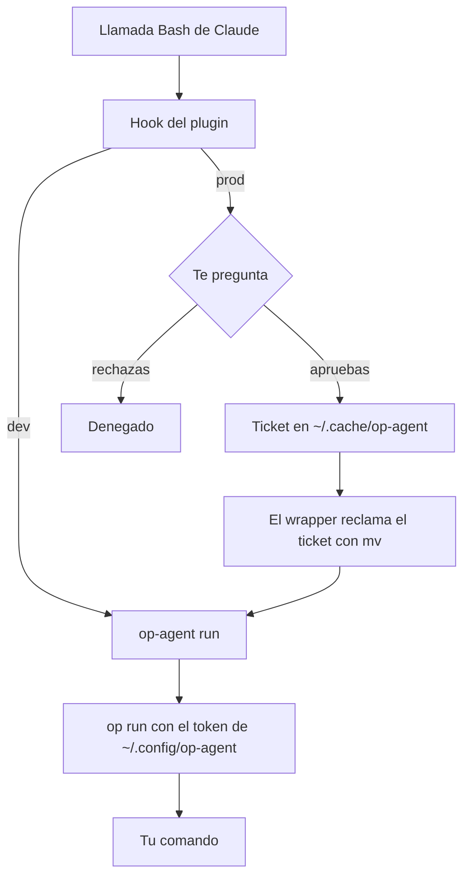

# op-agent

<p align="center"></p>
<p align="center">
  <a href="https://github.com/efrageek/op-agent/actions/workflows/ci.yml"></a>
  <a href="LICENSE"></a>
  <a href="https://github.com/efrageek/op-agent/releases"></a>
</p>

[English](README.md)

Secretos de Service Account de 1Password para Claude Code, sin la app de escritorio, así que sigue funcionando por Remote Control. Los secretos de dev corren sin preguntar. Los de prod te preguntan antes, y la pregunta te llega al celular por Remote Control.

- **dev**: `op-agent run ...` usa una Service Account que solo ve la bóveda `claude-dev`. Corre sin preguntar.
- **prod**: `op-agent --prod run ...` usa otra Service Account que solo ve `claude-prod`. El plugin te pregunta antes de correrlo, con las referencias `op://` y el comando. Si apruebas, deja un ticket de un solo uso (válido 2 minutos), y el wrapper rechaza `--prod` sin ese ticket. Un script que llame a `op-agent --prod` por su cuenta falla en vez de saltarse la pregunta.
- Los secretos solo entran al proceso. `op run` oculta sus valores en la salida, el wrapper solo acepta `run`, `ssh`, `ssh-window` y `ls`, bloquea `--no-masking` y le quita el token al proceso hijo.

## Qué protege y qué no

op-agent es un guardarraíl, no un sandbox. La aprobación de prod frena errores y agentes que no intentan saltársela. Claude corre como tu usuario, así que todo lo que pueda ejecutar como ese usuario también puede llegar a los archivos de token. Los límites duros son el alcance, la expiración y el contenido de cada bóveda de Service Account.

- **La barrera real es el alcance de cada token.** Aunque Claude se equivocara, el token de dev no puede leer prod. Mantén `claude-prod` mínima y de solo lectura, usa tokens que expiran y rótalos.
- **El plugin protege de errores, no de un agente decidido a saltárselo.** El plugin bloquea las rutas literales de los tokens y del ticket, pero un comando indirecto (`grep -r ~/.config`, `tar ~/.config`) puede llegar a ellos. Ese bloqueo es una ayuda, no una barrera.
- **El ticket no está atado al comando aprobado.** Otro proceso tuyo puede consumirlo dentro de 120 segundos, y los hijos del comando aprobado pueden usarlo.
- **Bajo NoNewPrivs (Claude Desktop)** el entorno (`/proc/<pid>/environ`) del proceso `op` en ejecución es legible por el mismo usuario mientras corre, incluidos los hijos del comando aprobado.
- **`ssh` y `ssh-window` sin `--prod` usan la bóveda dev** sin aprobación.
- **Durante una ssh-window**, cualquier proceso tuyo puede usar la llave contra cualquier host durante toda la ventana. Durante un `op-agent ssh` normal, el agente temporal también lo puede usar cualquier proceso tuyo hasta que termina el comando.
- **`op-agent run` le quita el token solo al comando que va después de `--`.** Si una opción de `op run` hace que el propio `op` lance otro programa, ese programa no queda cubierto.
- **Las herramientas fuera de Bash** no pasan por el hook del ticket. Prod falla cerrado ahí.
- **Los secretos de dev nunca preguntan.** Un valor transformado (base64, etc.) de un secreto de dev podría llegar a la conversación. Mantén `claude-dev` con secretos que puedas perder.
- **Ocultar valores tiene límites.** `op run` oculta los valores exactos, pero no un valor transformado (`base64`, cortado en partes) ni uno que el proceso escriba en un archivo que Claude lea después. Lee el comando antes de aprobar.
- **Cada uso de prod pregunta.** Un comando aprobado gasta su ticket en la primera llamada a `--prod`. Si un script necesita prod varias veces, envuélvelo entero en una sola llamada: `op-agent --prod run --env-file .env.prod -- ./deploy.sh`.
- Las referencias que muestra la pregunta se leen relativas a la carpeta de la sesión. Si el comando hace `cd`, puede que no coincidan.

## Requisitos

- Solo Linux.
- CLI de 1Password `op` en `/usr/bin/op`.
- bash y `jq`, en `/usr/bin/jq`. El wrapper llama a cada herramienta por ruta absoluta (`/usr/bin/uname`, `/usr/bin/mv`, …), así que necesita `/usr` unificado (lo normal en las distribuciones actuales).
- OpenSSH 9.6 o superior (para las funciones de ssh y el bloque `Match exec`).
- Una cuenta de 1Password que pueda crear Service Accounts.
- Claude Code. Probado con Claude Code 2.1.300.

## Instalación

En una sesión de Claude Code:

```
/plugin marketplace add efrageek/op-agent
/plugin install op-agent@op-agent
```

Mientras el plugin esté activo, su carpeta `bin/` está en el PATH del Bash de Claude. Para usar `op-agent` en tu propia terminal, clona el repo y crea un enlace simbólico. La ruta de la caché del plugin cambia con las actualizaciones, así que no enlaces a esa:

```bash
git clone https://github.com/efrageek/op-agent
ln -s "$PWD/op-agent/bin/op-agent" ~/.local/bin/op-agent
```

## Configuración (una vez)

Una Service Account no puede usar tus bóvedas personales ni compartidas, así que creas bóvedas nuevas que solo tú puedes abrir: los administradores no tienen acceso y tú eres el único Owner. Lo que se le da a una Service Account no se puede cambiar después, así que primero van las bóvedas. Corre esto tú, en tu propia terminal.

Bajo Claude Desktop (NoNewPrivs) el `op` normal no puede llegar a la app de escritorio. Corre estos comandos en tu propia terminal, o a través de [`scripts/op-host`](scripts/op-host).

1. Bóvedas privadas:

   ```bash
   op vault create claude-dev --account <tu-cuenta>.1password.com --allow-admins-to-manage false
   op vault create claude-prod --account <tu-cuenta>.1password.com --allow-admins-to-manage false
   ```

2. Copia a esas bóvedas solo los secretos que Claude necesita.
3. Service Accounts de solo lectura y con expiración. El token va directo a su archivo y nunca aparece en pantalla:

   ```bash
   mkdir -m 700 -p ~/.config/op-agent ~/.cache/op-agent
   (umask 077; op service-account create claude-agent --account <tu-cuenta>.1password.com --vault claude-dev:read_items --expires-in 90d --raw > ~/.config/op-agent/dev.token)
   (umask 077; op service-account create claude-agent-prod --account <tu-cuenta>.1password.com --vault claude-prod:read_items --expires-in 90d --raw > ~/.config/op-agent/prod.token)
   ```

4. Dile a Claude cómo usarlo, en `~/.claude/CLAUDE.md`:

   ```markdown
   - Secretos: `op-agent ls` para ver qué hay; luego `VAR='op://...' op-agent run -- <cmd>` (dev) o `op-agent --prod run -- <cmd>` (prod; me pregunta). Nunca leas ni imprimas valores.
   ```

## Uso

Para ver qué hay disponible, sin valores y con la referencia lista para copiar:

```bash
op-agent ls
```

Usa la referencia directamente en el comando:

```bash
VAR='op://claude-dev/Example API Key/credential' op-agent run -- npm test
VAR='op://claude-prod/Example Deploy Key/credential' op-agent --prod run -- ./deploy.sh
```

O ponlas en un archivo de proyecto (solo referencias, nunca valores), que es lo más cómodo cuando son muchas:

```bash
op-agent run --env-file .env.dev -- npm test
op-agent --prod run --env-file .env.prod -- ./deploy.sh
```

`op-agent ls` también usa el token de prod, pero solo imprime nombres de ítems y de campos (los valores se quedan dentro de `jq`), así que no pregunta.

### ssh

```bash
op-agent [--prod] ssh [--key <ítem>] <host> [comando]
```

La llave es el ítem que se llama igual que el alias del host; con `--key <ítem>` eliges otro. Carga el campo `private key` del ítem en un `ssh-agent` temporal (la llave pasa por una tubería, nunca por el entorno de un proceso) con `ssh-add -t 3600`, y obliga a ssh a usar ese agente aunque el alias de `~/.ssh/config` apunte al agente de 1Password. Si no, la app de escritorio pediría aprobación en la pantalla. IP, usuario y demás opciones siguen saliendo del alias. El host debe ser un alias de ssh_config o un nombre de host simple (sin `usuario@` ni opciones antes). Los títulos de ítem pueden usar letras, dígitos, espacios y `._()-`; para otros títulos usa el ID del ítem que muestra `op-agent ls`. La salida remota no se oculta: lo que el servidor imprima llega tal cual a la conversación.

```bash
op-agent --prod ssh example-host 'echo ok'
```

### ssh-window

Para scripts y herramientas que hacen ssh por su cuenta:

```bash
op-agent --prod ssh-window example-host 120   # una aprobación, 1-120 minutos
ssh example-host uptime                       # ssh normal, sin aviso en tu pantalla
op-agent ssh-window --close                   # cierra todas las ventanas ahora
```

Carga la llave del host en un `ssh-agent` propio (`~/.ssh/op-agent-<host>.sock`) con `ssh-add -t`, así que la llave se borra al terminar el tiempo. El proceso del agente sigue residente pero vacío. Para que funcione, pon un bloque por host al principio de `~/.ssh/config` (OpenSSH 9.6 o superior):

```
Match host example-host exec "SSH_AUTH_SOCK=%d/.ssh/op-agent-example-host.sock /usr/bin/ssh-add -l >/dev/null 2>&1"
  IdentityAgent %d/.ssh/op-agent-example-host.sock
```

Mientras ese agente tenga una llave, `ssh example-host` la usa. Cuando se vacía, ssh vuelve solo al agente de 1Password.

### Códigos de salida

- `1`: `op-agent ls` no pudo listar ninguna bóveda (¿token vencido?).
- `2`: error de uso o falta el archivo de token.
- `3`: `--prod` sin ticket de aprobación.
- `4`: no se pudo cargar la llave ssh.

## Cómo funciona



La ruta dev se salta la pregunta y el ticket. El hook anula cualquier ticket sin usar cuando termina el comando.

## Comandos que corren fuera de Claude Code

Cron, otros agentes y CI no pasan por el hook, así que nada pregunta y no existe ticket. `--prod` falla cerrado ahí (exit 3); dev funciona. Si un trabajo así necesita ssh, abre antes una `ssh-window` desde Claude.

## Limitaciones

- Solo Linux.
- Los nombres de bóveda son fijos: `claude-dev` y `claude-prod`.
- Un ticket por aprobación.
- Los comandos prod en paralelo no se coordinan.

## Desarrollo y pruebas

```bash
bash tests/wrapper.sh      # usa un `op` falso, sin red
claude plugin test .       # el hook
```

## Rotación y revocación

- Los tokens expiran (se sugieren 90 días). `op-agent ls` avisa qué perfil falla (`<perfil> listing failed`).
- Las copias de ítems en las bóvedas claude no siguen las rotaciones de los originales: vuelve a copiarlas.
- En Ubuntu, para que un volcado de memoria no contenga el token, excluye `/usr/bin/op` de apport (corre esto tú, con sudo):

  ```bash
  echo /usr/bin/op | sudo tee /etc/apport/report-ignore/op-agent
  ```

## Licencia

MIT. Ver [LICENSE](LICENSE).

## Aviso

op-agent es un proyecto independiente y no oficial. No está afiliado a 1Password ni a Anthropic, ni cuenta con su respaldo o patrocinio. 1Password es una marca de su titular; Claude y Claude Code son marcas de Anthropic, PBC.
