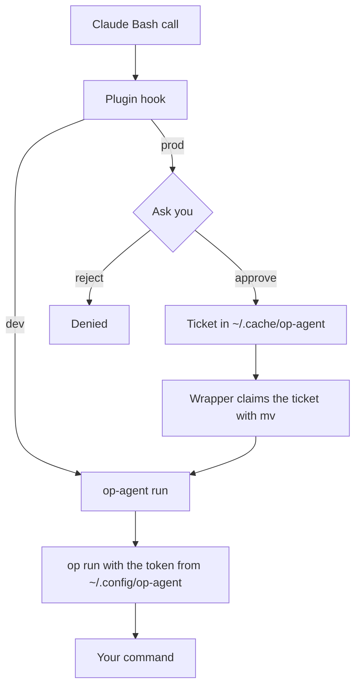

# op-agent

<p align="center"></p>
<p align="center">
  <a href="https://github.com/efrageek/op-agent/actions/workflows/ci.yml"></a>
  <a href="LICENSE"></a>
  <a href="https://github.com/efrageek/op-agent/releases"></a>
</p>

[Español](README.es.md)

1Password Service Account secrets for Claude Code, without the desktop app, so it keeps working over Remote Control. Dev secrets run freely. Prod secrets ask you first, and the question reaches your phone over Remote Control.

- **dev**: `op-agent run ...` uses a Service Account that only sees the `claude-dev` vault. It runs without asking.
- **prod**: `op-agent --prod run ...` uses another Service Account that only sees `claude-prod`. The plugin asks before it runs, showing the `op://` references and the command. If you approve, it leaves a one-use ticket (valid 2 minutes), and the wrapper refuses `--prod` without that ticket. A script that calls `op-agent --prod` on its own fails instead of skipping the question.
- Secrets only enter the process. `op run` masks their values in the output, the wrapper only accepts `run`, `ssh`, `ssh-window` and `ls`, it blocks `--no-masking`, and it strips the token from the child process.

## What it protects and what it doesn't

op-agent is a guardrail, not a sandbox. The prod approval stops mistakes and agents that are not trying to get around it. Claude runs as your user, so anything it can execute as that user can also reach the token files. The hard limits are the scope, expiry and contents of each Service Account vault.

- **The real barrier is the scope of each token.** Even if Claude made a mistake, the dev token cannot read prod. Keep `claude-prod` minimal and read-only, use tokens that expire, and rotate them.
- **The plugin protects against mistakes, not against an agent set on getting around it.** The plugin blocks the literal paths of the tokens and the ticket, but an indirect command (`grep -r ~/.config`, `tar ~/.config`) can reach them. That block is a help, not a barrier.
- **The ticket is not bound to the approved command.** Another process of yours can consume it within 120 seconds, and children of the approved command can use it.
- **Under NoNewPrivs (Claude Desktop)** the environment (`/proc/<pid>/environ`) of the running `op` process is readable by the same user while it runs, including by children of the approved command.
- **`ssh` and `ssh-window` without `--prod` use the dev vault** with no approval.
- **During an ssh-window**, any process of yours can use the key against any host for the whole window. During a plain `op-agent ssh`, the throwaway agent is also usable by any process of yours until the command ends.
- **`op-agent run` removes the token only from the command after `--`.** If an `op run` option makes `op` itself start another program, that program is not covered.
- **Tools outside Bash** do not go through the ticket hook. Prod fails closed there.
- **Dev secrets never ask.** A transformed value (base64, etc.) of a dev secret could reach the conversation. Keep `claude-dev` limited to secrets you can afford to lose.
- **Masking has limits.** `op run` masks the exact values, but not a transformed value (`base64`, split into pieces) or one the process writes to a file that Claude reads later. Read the command before you approve.
- **Every prod use asks.** An approved command spends its ticket on the first `--prod` call. If a script needs prod several times, wrap it whole in one call: `op-agent --prod run --env-file .env.prod -- ./deploy.sh`.
- The references shown in the prompt are read relative to the session directory. If the command does a `cd`, they may not match.

## Requirements

- Linux only.
- 1Password CLI `op` at `/usr/bin/op`.
- bash and `jq`, at `/usr/bin/jq`. The wrapper calls every tool by absolute path (`/usr/bin/uname`, `/usr/bin/mv`, …), so it needs a merged `/usr` (the default on current distributions).
- OpenSSH 9.6 or newer (for the ssh features and the `Match exec` block).
- A 1Password account that can create Service Accounts.
- Claude Code. Tested with Claude Code 2.1.300.

## Install

In a Claude Code session:

```
/plugin marketplace add efrageek/op-agent
/plugin install op-agent@op-agent
```

While the plugin is enabled, its `bin/` folder is on Claude's Bash PATH. To use `op-agent` in your own terminal, clone the repo and symlink it. The plugin cache path changes on updates, so do not link to that:

```bash
git clone https://github.com/efrageek/op-agent
ln -s "$PWD/op-agent/bin/op-agent" ~/.local/bin/op-agent
```

## Setup (once)

A Service Account cannot use your personal or shared vaults, so you create new vaults that only you can open: admins get no access and you are the only Owner. What you give a Service Account cannot be changed later, so the vaults come first. Run this yourself, in your own terminal.

Under Claude Desktop (NoNewPrivs) plain `op` cannot reach the desktop app. Run these commands in your own terminal, or through [`scripts/op-host`](scripts/op-host).

1. Private vaults:

   ```bash
   op vault create claude-dev --account <your-account>.1password.com --allow-admins-to-manage false
   op vault create claude-prod --account <your-account>.1password.com --allow-admins-to-manage false
   ```

2. Copy only the secrets Claude needs into those vaults.
3. Read-only Service Accounts that expire. The token goes straight to its file and is never shown:

   ```bash
   mkdir -m 700 -p ~/.config/op-agent ~/.cache/op-agent
   (umask 077; op service-account create claude-agent --account <your-account>.1password.com --vault claude-dev:read_items --expires-in 90d --raw > ~/.config/op-agent/dev.token)
   (umask 077; op service-account create claude-agent-prod --account <your-account>.1password.com --vault claude-prod:read_items --expires-in 90d --raw > ~/.config/op-agent/prod.token)
   ```

4. Tell Claude how to use it, in `~/.claude/CLAUDE.md`:

   ```markdown
   - Secrets: `op-agent ls` to see what exists; then `VAR='op://...' op-agent run -- <cmd>` (dev) or `op-agent --prod run -- <cmd>` (prod; it asks me). Never read or print values.
   ```

## Usage

List what is available, with no values and the reference ready to copy:

```bash
op-agent ls
```

Use the reference directly in the command:

```bash
VAR='op://claude-dev/Example API Key/credential' op-agent run -- npm test
VAR='op://claude-prod/Example Deploy Key/credential' op-agent --prod run -- ./deploy.sh
```

Or put references in a project file (references only, never values), which is handy when there are many:

```bash
op-agent run --env-file .env.dev -- npm test
op-agent --prod run --env-file .env.prod -- ./deploy.sh
```

`op-agent ls` also uses the prod token, but it only prints item and field names (values stay inside `jq`), so it does not ask.

### ssh

```bash
op-agent [--prod] ssh [--key <item>] <host> [command]
```

The key is the item named like the host alias; `--key <item>` picks another. It loads the item's `private key` field into a temporary `ssh-agent` (the key goes through a pipe, never through a process environment) with `ssh-add -t 3600`, and forces ssh to use that agent even if the `~/.ssh/config` alias points at the 1Password agent. Otherwise the desktop app would ask for approval on screen. IP, user and other options still come from the alias. The host must be an ssh_config alias or plain host name (no `user@`, no options before it). Item titles may use letters, digits, spaces and `._()-`; for other titles use the item ID that `op-agent ls` shows. Remote output is not masked: whatever the server prints reaches the conversation.

```bash
op-agent --prod ssh example-host 'echo ok'
```

### ssh-window

For scripts and tools that run ssh on their own:

```bash
op-agent --prod ssh-window example-host 120   # one approval, 1-120 minutes
ssh example-host uptime                       # plain ssh, no prompt on your screen
op-agent ssh-window --close                   # end every window now
```

It loads the host's key into a dedicated `ssh-agent` (`~/.ssh/op-agent-<host>.sock`) with `ssh-add -t`, so the key is dropped when the time ends. The agent process stays resident but empty. For this to work, put one block per host at the top of `~/.ssh/config` (OpenSSH 9.6 or newer):

```
Match host example-host exec "SSH_AUTH_SOCK=%d/.ssh/op-agent-example-host.sock /usr/bin/ssh-add -l >/dev/null 2>&1"
  IdentityAgent %d/.ssh/op-agent-example-host.sock
```

While that agent holds a key, `ssh example-host` uses it. When it is empty, ssh falls back to the 1Password agent by itself.

### Exit codes

- `1`: `op-agent ls` could not list any vault (token expired?).
- `2`: usage error or missing token file.
- `3`: `--prod` without an approval ticket.
- `4`: the ssh key could not be loaded.

## How it works



The dev path skips the question and the ticket. The hook voids any unused ticket when the command ends.

## Commands that run outside Claude Code

Cron, other agents and CI do not go through the hook, so nothing asks and no ticket exists. `--prod` fails closed there (exit 3); dev works. If such a job needs ssh, open an `ssh-window` from Claude first.

## Limitations

- Linux only.
- Vault names are fixed: `claude-dev` and `claude-prod`.
- One ticket per approval.
- Parallel prod commands are not coordinated.

## Development & tests

```bash
bash tests/wrapper.sh      # uses a stub `op`, no network
claude plugin test .       # the hook
```

## Rotation & revocation

- Tokens expire (90 days suggested). `op-agent ls` reports which profile fails (`<profile> listing failed`).
- Copies of items in the claude vaults do not follow rotations of the originals: copy them again.
- On Ubuntu, to keep the token out of crash dumps, exclude `/usr/bin/op` from apport (run this yourself, with sudo):

  ```bash
  echo /usr/bin/op | sudo tee /etc/apport/report-ignore/op-agent
  ```

## License

MIT. See [LICENSE](LICENSE).

## Disclaimer

op-agent is an independent, unofficial project. It is not affiliated with, endorsed by, or sponsored by 1Password or Anthropic. 1Password is a trademark of its owner; Claude and Claude Code are trademarks of Anthropic, PBC.
